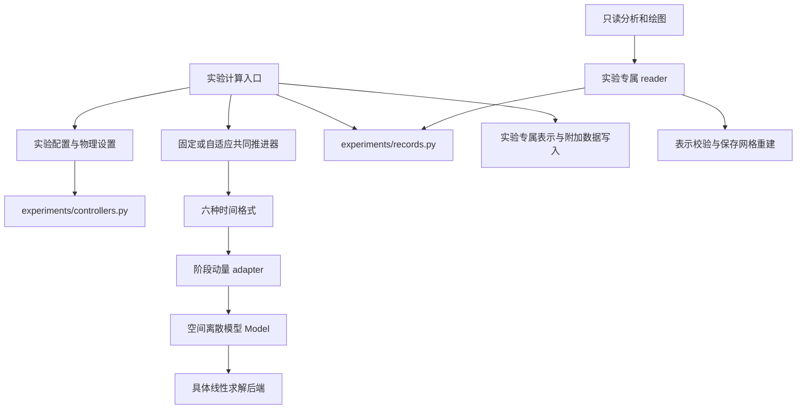

# 当前架构与修改导航

本文件描述当前实现，是修改模块归属、依赖、控制器配置、存储和分析时的阅读入口。
改变这些约定时，在同一提交中更新相应章节及测试入口。数值范围与用户确认事项见
[CONTEXT](../CONTEXT.md)、[规格](spec.md)；术语见 [GLOSSARY](../GLOSSARY.md)；
已验证结果、跳过项和未覆盖场景见[验证记录](validation.md)。历史说明中的首期限制
应结合后续扩展阅读，不能用旧范围推断当前能力。

## 修改从哪里开始

| 修改对象 | 归属与阅读入口 | 修改时保留的约定 |
| --- | --- | --- |
| 时间格式、阶段和标量校正 | [schemes](../solver/schemes/registry.py)、[Model 协议](../solver/model.py)、[数值说明](numerics.md) | 六种格式共用空间离散模型接缝，不在格式中复制 FEM/MAC 专属公式 |
| 动量表示或 FEM 对流/SAV 功 | [共同动量 adapter](../solver/momentum.py)、[FEM 弱载荷 adapter](../solver/fem/momentum.py)、下文 FEM 章节 | 物理装配和表示转换分别维护；完整残差与约束检查保留 |
| I/PI 配置与序列化 | [controllers.py](../experiments/controllers.py) | 实验默认值与启用策略留在各实验配置中 |
| 运行身份、保存、复用、完成状态 | [records.py](../experiments/records.py)、下文记录章节 | 来源与校验和、旧可选键、失败前缀、专属表示校验保留 |
| 网格、布局、压力标签、读取重建 | 各实验 `records.py` / `representation.py` / `reconstruct.py` | 读取实际保存网格；区分阶段乘子与瞬时半离散压力 |
| 绘图与结果分析 | 各实验 `analyze.py` / `animate.py`，MAC 通用 [analysis.py](../experiments/analysis.py) | 只接受显式记录，输出到 `reports/`，不启动计算 |
| 实验参数、物理观测或计算调度 | 各实验 `config.py` / `problems.py` / `run.py`，见[实验导航](../experiments/README.md) | 共用已有推进与记录机制；实验特有物理内容留在实验内 |

这些文件名是常见归属，不要求每个实验机械地复制整套文件。周期与 Channel 配置目前
仍在各自 `run.py`；封闭 FEM、圆柱和 Hele–Shaw 有独立 `config.py`。楔腔还保存逐帧
阶段压力，计算循环有专属实现。

## 调用关系

下图表示职责间的调用方向。新代码沿已有接缝扩展，不通过分析入口反向调用计算入口。

模型、阶段推进、持久化和绘图分别拥有自己的职责。MAC、Legendre 谱、Fourier、Channel
和 FEM 是真实的空间离散选择；Riesz 与弱载荷也是实际存在的表示差异，保留相应 adapter。

## 时间推进、状态与线性求解

当前实现六种格式：`imex_euler/imex_euler_mrsav`、`sdirk2/sdirk2_mrsav`、
`sdirk3/sdirk3_mrsav`，分别为一/二/三阶、单/两/四阶段。五类空间离散为 MAC、
Legendre、Fourier、Channel 和 FEM；完整能力表见[项目总览](../README.md#当前算法与支持范围)。
六格式均支持固定/给定步长，四种 SDIRK 格式支持嵌入式 I/PI；Euler 尚无自适应估计器。
`DEFAULT_SCHEMES` 的四种研究默认值不是全部格式清单。共同推进能力与实验入口允许的
配置分别描述：例如通用 MAC 固定步 runner 使用 direct；楔腔入口可选六格式固定步，
默认 SDIRK2-mr-ccSAV，未开放自适应或给定步长序列。
FEM 的 Brinkman/Hele–Shaw 是物理模型扩展，Darcy 是独立标量参照；Riesz/弱载荷是动量
表示选择，均不另计为空间离散或时间格式。可选后端的实测资格见各后端文档。
[FourierMHD](../solver/fourier/mhd.py) 复用同一 Fourier 空间与共同推进/校正，在同一乘积
内积下推进速度和磁场。谱系数形状为 `(2, 2, ny, nx//2+1)`，两块各用物理扩散系数。
Leray 消去阶段压力，感应方程用反对称通量。阶段残差针对完整投影方程，散度覆盖两个场
全部格点。实验入口首期开放两种 SDIRK3 的固定步。
[ForcedFourierMHD](../solver/fourier/forced_mhd.py) 是独立受迫扩展：两场共用正乘子
`nu_plus*|k|^4+nu_minus*|k|^-4`，零模的逆幂取零。共同格式仍以 `model.nu=nu_plus`
乘 `apply_K`；后者包含两条耗散通道。加性外源不乘 SAV 耦合因子，不复制阶段公式。
同文件拥有零均值磁通重建及原 PDE 非线性通量／壳层谱诊断，面积平均和 rFFT 权重一致。
[逆级联实验](../experiments/inverse_cascade/README.md) 的 config/problem 拥有论文单位、
定常双场外源和可复现扰动初值；run 通过接受态 observer 抽样谱，不在分析时重新计算流动。
同目录另有四个只读或执行辅助模块，职责不得混用：

| 模块 | 归属 | 契约 |
| --- | --- | --- |
| [stats.py](../experiments/inverse_cascade/stats.py) | 相关系数与有限窗筛查 | 只接受均匀采样的标量序列；常量、样本不足返回明确状态，不造有限误差 |
| [segments.py](../experiments/inverse_cascade/segments.py) | 分段执行与 checkpoint | 每段调用同一 `integrate`；只在段边界原子发布；未达计划终点不标完成 |
| [chain.py](../experiments/inverse_cascade/chain.py) | chain 的只读组装 | 拒绝缺段、重叠时间、重复采样、校验和变化与未完成段；不构造模型 |
| [inventory.py](../experiments/inverse_cascade/inventory.py) / [plan.py](../experiments/inverse_cascade/plan.py) | 探索性库存与部分候选预算 | inventory 只读扫描；plan 默认 dry run，显式本地 execute 须配置/代码/证据绑定的人工审批；无远程提交 |

分段 chain 是独立记录家族（`runs/inverse_cascade_chains/<id>/`）：
`chain.json` 拥有段索引、累积步数、样本数与分段校验和，`manifest.json` 仍走
公共开始/完成流程；schema 2 的 `results_sha256` 为段及 checkpoint 元数据校验和的有序摘要。
新记录绑定父 checkpoint、配置/来源身份、全局采样相位及完整接受态连续性；failed 不可续算。
所有提交段在重启前逐个校验，`load_chain(assemble=False)` 不累计全历史；空谱采样段合法。
单写者锁、孤儿文件及不一致提交一律 fail closed，需人工检查；不承诺断电事务恢复。
max_wall_seconds 仅在段边界检查。旧 schema 1 可只读，但不能用当前实现续算历史来源。
分析入口用 `--chain` 转成与单次运行相同的数组接口；分析仍组装完整历史，非流式分析。
分析 schema 3 修正 IPS、注入尺度漂移、双非重叠窗筛查、完整块区间中心；不改阶段算法。
执行审批检查具名人工审阅及文件完整性，不证明科学判断；37 条候选矩阵不是完整研究规范。
详见[审计及兼容限制](inverse-cascade-toolchain-audit.md)。

- [core.py](../solver/core.py) 定义 `State`、`History`、`Trial`、`Stage` 与格式协议。
  单步格式不改写输入状态，返回试算结果；共同推进器负责接受状态与历史记录。
- [registry.py](../solver/schemes/registry.py) 是格式名称、工厂、阶数、估计器阶数、阶段数
  和根容量的归属。增加格式时修改注册信息，调用方从中取得存储容量，不按名称猜阶数。
- [integrate.py](../solver/integrate.py) 管理固定/给定步长；[adaptivity](../solver/adaptivity/controller.py)
  管理 I/PI 接受、拒绝、速度误差与可选标量缺陷控制。[schedule.py](../solver/schedule.py)
  管理给定序列的累计节点和最近快照节点选择。
- `Model` 隐藏空间布局。MAC 的交错面、Channel 的重复周期末列、Fourier 的实数输出/
  内部复系数和 FEM 的完整 P2 分量系数不能互相当作相同数组使用。
- 移位 Stokes 缓存使用精确系数键；改变网格需要新建模型。直接、张量、recycled、PETSc
  等后端按各空间离散的约定实现，不能用近似步长或较弱的残差检查冒充等价加速。
- 弱不可压约束残差与物理散度分别保存和检查；压力零均值按物理积分定义。自然流出压力
  不沿用封闭域规范。具体矩阵、缓存、残差及可选依赖见各模型文档。

共同推进器保留当前状态、每步标量诊断、最后接受步的阶段压力及指定快照，不默认保存
每一步全场。诊断、阶段和根历史随步数增长。快照保存请求与实际时刻；最近节点同距时
取较早节点。失败试算不成为接受结果；已接受状态及允许保存的前缀保留。自适应终点可
用短于最小步长的对齐步，但仍执行原有误差和阶段检查。显式 `min_step_policy=force`
另有允许有限超容差下限步的规则，见[规格](spec.md)，不据此声明原容差已满足。

## 共享固定次数标量校正与记录

solver/schemes/scalar_correction.py拥有公共标量商和固定次数1/1/2，返回校正序列、
预测值、倒数第二次迭代处的冻结因子及最终耦合系数。各SAV格式构造自己的阶段右端、
alpha/beta和预测值，再用同一耦合恢复速度/压力并验证冻结方程。
动量adapter保留质量与lifting配对，校正不引入新的模型接口或Stokes求解。
registry的n_corrections对普通格式为0、SAV为1/1/2；n_roots保留历史存储预留容量。

experiments/records.py的save_scalar_corrections共用写入附加标量诊断；公共save_result
与楔腔独立循环都调用它。Molenaar流式布局另有同接受步对齐的scalar_corrections数据集，
列为count/predictor/r1/r2/frozen_factor，保留原stage_records历史根槽。

Stage的corrections、correction_predictor、frozen_factor是当前标量诊断，
stage_diagnostics由固定与自适应推进器共用。当前candidates/root_residuals为空，
不再把校正值当成原自洽多项式的实根；普通格式的校正序列也为空。

公共HDF5保留schema_version=1并增添scalar_solver、stages/r和
corrections/count/values/predictor/frozen_factor。
scalar_solver为fixed_count_frozen_factor时，count必须按阶数为1/1/2，
values末值等于阶段r，冻结因子对应倒数第二次迭代值；unused位置填NaN。
普通格式scalar_solver为none、count为0。FEM及复用其校验的圆柱/Hele–Shaw读取器
验证次数、有限性、填充、末值及冻结因子一致性。

roots/*的历史预留形状不变；当前根计数为0，候选和根残差均为NaN。
roots/selected是stages/r的兼容别名，不能解释为原多项式的实根。
没有scalar_solver属性的旧记录继续执行历史实根候选校验；不回填校正字段或重写来源。
来源哈希区分新旧算法，旧冻结worker保留其原实现和导入路径。

## 控制器配置只在共同入口实现

[experiments/controllers.py](../experiments/controllers.py) 拥有：

- `make_controller`：I/PI 构建、嵌入估计器阶数匹配、`max_step=null` 到内部无穷的转换。
  `max_steps`、`max_rejections` 必须是整数，布尔值和浮点数不作为整数接受。
- `controller_settings`：将实际控制器转成可保存的配置，无穷最大步长写为 JSON `null`。

每个实验仍拥有默认容差、初始步长、快照规则及是否允许联合标量控制。新增当前源码调用方
直接导入共同模块，不依赖周期实验的 `run.py`。控制器的数值更新公式仍在 `solver/adaptivity`。

## FEM 物理装配与表示转换

每种 FEM 物理模型通过 `_convection_load_with_lifting` 集中计算对流弱载荷与 SAV 功。

| 归属 | 职责 |
| --- | --- |
| [FEMModel](../solver/fem/model.py) | 默认齐次封闭装配；共同 Riesz 质量逆、有限性检查与计时；共同弱载荷返回入口 |
| [ClosedCavityModel](../solver/fem/cavity.py) | 固定顶盖迹和同一体积求积下的 lifting 配对，保留封闭压力规范 |
| [OpenFlowModel](../solver/fem/open_flow.py) | 同一体积对流、边界 transport、对流边界能量通量与 SAV 边界功 |
| [HeleShawModel](../solver/fem/hele_shaw.py) | MWR 系数、反应项、压力入口和可选入口动能修正；沿用开放流动装配 |
| [FEMMomentum](../solver/fem/momentum.py) | 弱动量表示、载荷配对与求解；物理状态仍为同一速度系数 |

修改物理装配时，让 Riesz 与弱载荷共用同一公式。`_nonlinear_load_with_lifting` 是弱载荷
表示的缩放扩展点；Hele–Shaw 的 beta 在弱载荷路径中先缩放载荷，Riesz 路径保持质量逆后
再缩放的既有运算顺序。不要因复用装配而重复缩放或改变顺序。

一致质量、固定迹、SAV边界功和完整残差检查保持原义；标量校正采用[ADR0002](adr/0002-fixed-sav-corrections.md)。多右端 Stokes 的第一列携带已知
边界/连续性载荷，SAV 修正列为齐次响应；物理散度检查覆盖完整场。弱载荷残差仍使用一致
质量逆，较保守的归一化不能替代原方程检查。开放流动配对与压力约定见
[ADR0001](adr/0001-open-flow-sav-boundary-work.md)；性能配置见
[FEM 优化](fem-optimization.md)及[多重网格对照](fem-multigrid.md)。

## 运行记录的共同流程与专属读取

[experiments/records.py](../experiments/records.py) 拥有共同机制：

| 函数 | 职责 |
| --- | --- |
| `run_identity` / `provenance` | 有效配置与来源的身份编码；代码、依赖、平台、线程环境记录 |
| `write_json` / `save_result` | 临时文件写入并替换；公共 HDF5 结果布局 |
| `load_record` | 配置/结果校验和及完成状态的共同检查，不替代专属表示校验 |
| `reusable_run` | 经专属 reader 查找同配置、同来源、同身份的完整结果 |
| `begin_run` | 新建尝试，保存配置、配置摘要和 running manifest |
| `finish_run` / `fail_run` | 已发布结果的完成状态，或无法产生结果时的设置/存储失败记录 |

计算入口先解析有效配置、补齐计算所需的来源信息，再查找可复用记录或新建尝试；模型
构造和积分仍由计算入口负责。公共结果先写入 pending 文件，实验补齐网格、标签、物理
观测及 attempts 后发布 `results.h5`，再最终化 manifest。MAC 与楔腔保留各自原有写入/
复用流程中的专属策略，建立和完成记录使用共同函数。保留各家族 `started`、`created_utc`、
`finished_utc` 等原字段约定，不为统一外观重命名旧字段。

| 记录家族 | 当前读取入口 | 校验或重建扩展 |
| --- | --- | --- |
| 通用 MAC | [load_record](../experiments/records.py) | [plotting.py](../experiments/plotting.py) 等 MAC 读取处理 |
| 排版/外部工具 | [plotting.py](../experiments/plotting.py) 的 `latex_binary`、`usetex_available`、`latex_style` | 唯一工具定位入口：先查 `PATH`，再查 `/Library/TeX/texbin`、`/usr/local/texlive/*/bin/*` 等标准位置（MacTeX 常不在非登录 shell 的 `PATH`）。`latex_style` 有工具链时启用 `text.usetex`、否则回退 mathtext；需要 PDF 表的分析（no_slip 参考收敛等）经此判断是否编译，缺工具记 `pdf_status` 而不是数值失败 |
| 周期 Fourier | [periodic_ns/records.py](../experiments/periodic_ns/records.py) 的 `load_periodic` | Fourier 表示、布局与压力标签 |
| 周期 Fourier MHD | [periodic_mhd/records.py](../experiments/periodic_mhd/records.py) 的 `load_mhd` | 独立记录家族，补充 `final/magnetic`、`snapshots/magnetic`，省略阶段压力，检查两次校正计数。Zhou 算例另外保存和校验 `snapshots/flux` 与 `snapshots/current`，由 [analyze_zhou](../experiments/periodic_mhd/analyze_zhou.py) 读取两条显式运行记录 |
| 受迫 MHD 逆级联 | [inverse_cascade/records.py](../experiments/inverse_cascade/records.py) 的 `load` | 独立记录家族，复用公共 HDF5 与来源机制；补充磁场及 `spectra/{times,K,Pi_E,Pi_Q,E_u,E_B}`，检查谱抽样与接受步对齐、双场形状及两次标量校正。低通收支列 `E_low/Q_low/power_*_low/diss_*_low` 为**可选**：新记录写入并校验形状，旧记录缺列不得报错、不回填。只读分析显式指定运行、完成扫描或 chain，burn-in/块长为分析参数，不自动扫描或求解 |
| Channel | [channel_ns/records.py](../experiments/channel_ns/records.py) 的 `load_channel` | 周期面布局、壁面与阶段压力 |
| 封闭 FEM | [fem_ns/records.py](../experiments/fem_ns/records.py) 的 `load_fem` | 独立配置、网格/DOF、系数与阶段/根检查 |
| 圆柱 FEM | [cylinder_ns/records.py](../experiments/cylinder_ns/records.py) 的 `load_cylinder` | 专属表示与物理观测；同文件还拥有 native benchmark 读取 |
| Hele–Shaw | [hele_shaw_airfoil/records.py](../experiments/hele_shaw_airfoil/records.py) 的 `load` | 实际网格、MWR 压力/力与 Darcy 参照 |
| 楔腔 | [wedge_cavity/report.py](../experiments/wedge_cavity/report.py) 的 `load` | 专属快照和逐帧阶段压力布局、旧配置约定 |

新只读代码直接导入专属 reader 与共同记录工具，不从计算入口取得读取函数。读取可按
保存网格重建基函数、插值和表示检查，不构造动力模型、重生成网格或启动积分。PETSc、
Gmsh 等计算依赖保持按需导入；已有保存网格的读取不要求这些依赖。

### 历史兼容与冻结源码

- `experiments/workflow.py` 保留 MAC 计算入口和公共工具旧名的兼容导出；各实验 `run.py`
  保留 `load_*` 旧名导出。新当前源码调用方使用新的归属，旧调用路径不承载另一份实现。
- 冻结源码可能没有 `experiments.records` 或 `experiments.controllers`。在指定旧源码中
  运行的 worker/脚本保留该源码支持的导入路径。已存在的兼容入口包括圆柱对比 `WORKER`、
  三个 Kolmogorov `--source-root` 入口，以及 [FEM benchmark worker](../tools/benchmark_fem_adaptive.py)。
  修改这类入口时检查其实际解释器、工作目录和选定源码，不能只验证当前源码导入。
- 新配置不自动给旧可选参数补默认键；读取旧记录使用记录自带的来源计算身份。修改代码
  会改变新运行的来源哈希，不把新代码标记成旧来源，也不重写旧配置或结果。
- 实验表示标签明确区分自然出口、回流耗散出口及压力入口修正；瞬时半离散物理压力与
  阶段增量乘子分别命名。旧楔腔缺少字段时保留真实的 `r0=1`、移动角点解释；当前默认
  `r0=0`、静止角点不回填到旧记录。

## 保存布局与分析约定

`runs/<实验名>/<运行编号>/` 保存有效 `config.json`、含来源/状态/校验和的 `manifest.json`、
公共工作流的 `results.h5` 和 `run.log`。专属研究也有 NPZ/JSON 命名空间，以对应家族说明为准。
公共 HDF5 保存时间/步长、诊断、最终状态、请求/实际快照节点、阶段残差、标量校正诊断和历史根槽。

低/高频制造解诊断由 `tools/rerun_low_high_stability_probe.py` 重跑当前格式，
沿用独立 `runs/low_high_stability_probe/<run-id>/` NPZ/JSON 命名空间。
它读取显式旧基准参数、创建新身份并保存当前源码；不将新固定校正冒充旧求根结果。
schema 2 的九列历史以 metadata/history_columns 为准，其中第六列记录实际耦合因子偏离1的最大值；
额外 `stage_records` 保存两次校正、预测值、冻结因子、实际耦合及完整残差，
以 `stage_times=history[1:,0]` 对齐，列名由 metadata/stage_columns 给出。
对应报告内的 `plot.py`、`verify.py` 仅读取显式运行目录，旧schema 1及旧报告保持原记录。
`tools/search_low_high_stability_steps.py`复用该计算入口，仅覆盖有效配置的dt，
在`step_search/<batch-id>/cases/`保存各步长两方法的新运行；搜索索引保留全部状态，
按全过程SAV误差、前期精度及原格式范数爆破条件筛选。并发进程数是执行控制，不改数值公式。
`tools`是可导入的辅助脚本包，命令行入口仍可直接执行；分析脚本仅读显式完成批次及已核验基准。
128²长算将当前数值源码冻结到`search_128/<job-id>/source`，从该副本导入并保存每档记录。
独立报告的state/completion标记计算、核验和绘图阶段；短窗定位与正式T=30表分开，
必要的T=40观察单列，不把线性化Ritz筛查或短窗成功当作完整非线性资格。

阶段数和候选容量由 registry 指定：Euler 为 1/1，SDIRK2 为 2/3，SDIRK3 为 4/5；当前所有格式
的实际根计数为零，不使用的候选位置填 NaN。`final/stage_pressure` 是最后接受步的阶段乘子。

FEM 保存实际网格、DOF 映射和完整 P2/P1 系数；压力规范及所需库版本随表示检查。快照中
是否存在物理压力以专属标签为准，不能从阶段乘子推定同阶端点压力。更具体的布局见
[FEM](fem.md)、[Channel](channel.md)、[Fourier](fourier.md)、[谱方法](spectral.md)、
[Hele–Shaw](hele-shaw.md)和[回流出口](backflow-outlet.md)。

`--rerun` 新建尝试，失败或损坏记录不当作完整结果复用。设置/存储失败可能只有 manifest
和日志，读取仍需具备完整性检查所要求的文件。强制结束可能留下 running 或临时文件；
没有 checkpoint 续算或持久化事务保证。

分析只消费显式运行/批次编号，输出到 `reports/<分析名>/<分析编号>/`，记录输入路径、
校验和、分析代码来源、参数与状态。项目内输入使用可迁移的项目相对路径。失败前缀可
作诊断，精度/收敛表要求完整且兼容的记录。参考细化差是敏感性证据，不是严格误差上界。

## 修改后的验证与文档维护

| 修改内容 | 优先运行的已有测试 |
| --- | --- |
| 受迫 MHD 高／负阶耗散与通量 | `tests/test_forced_mhd.py`；论文外源、运行／复用／只读统计见 `tests/test_inverse_cascade_workflow.py` |
| 共同控制器配置 | `tests/test_controller_config.py` 及受影响家族的 workflow 测试 |
| FEM 装配或动量表示 | `tests/test_fem_weak_load.py`；边界功另查 `test_backflow_outlet.py`、`test_wedge_cavity.py`、`test_hele_shaw_inlet.py` 的独立参照 |
| 保存、复用、只读加载 | 各家族 workflow 测试；`tests/test_fem_workflow.py` 含独立进程读取与 rerun/损坏检查 |
| 自适应接受、终点、失败观测 | `tests/test_adaptivity.py`、`test_min_step_policy.py`、`test_accepted_observers.py` |
| 线性后端或可选依赖 | 对应算子/求解器测试和完整阶段测试；单独报告跳过项的覆盖限制 |

每次数值修改后运行相关测试，持续运行 `uv run --locked mypy`；发布/合并代码前运行
`uv run --locked pytest -q`。仅文档变动检查链接、描述与源码的一致性，不把上一次完整测试
写成本次重跑。验证结果与限制写入 [validation.md](validation.md)，不在本文件复制容易
过期的测试数量或性能排名。新增测试验证公开行为和独立参照，不复制内部函数的实现。

修改归属或接缝时更新本文件对应章节；用户确认范围改变时更新 [spec.md](spec.md) 与
[CONTEXT](../CONTEXT.md)；领域术语和有实质取舍的决定分别进入 GLOSSARY 与 ADR。
保留模型、推进、持久化和分析的分工，避免在新的计算入口或 reader 中重新复制共同机制。
